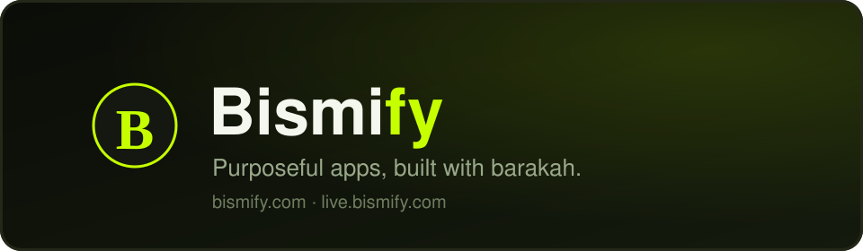

### بِسْمِ اللهِ

**Purposeful apps, built with barakah.**

Bismify is an independent app studio. We build tools that respect the person using them: no ads, no trackers, no data sold, no hidden agendas. Every app starts with an intention, stays honest about what it does, and keeps your data on your own device.

## Our apps

**Bismi Live** — live-stream your mobile gameplay straight to YouTube over RTMPS while recording a local MP4 copy of every session. A floating widget keeps your controls one tap away, your mic mixes cleanly over game audio, and nothing you record ever touches our servers.

- Site: [live.bismify.com](https://live.bismify.com)
- Download the latest APK: [bismify/bismi-live-releases/releases/latest](https://github.com/bismify/bismi-live-releases/releases/latest)

## Find us

- Website: [bismify.com](https://bismify.com)
- Bismi Live site: [live.bismify.com](https://live.bismify.com)

## What is next

More apps are on the way, ingsha Allah, each one held to the same standard: purposeful, private, and built with sincerity.

---

*Alhamdulillah — built with sincerity, for the Ummah and beyond.*

